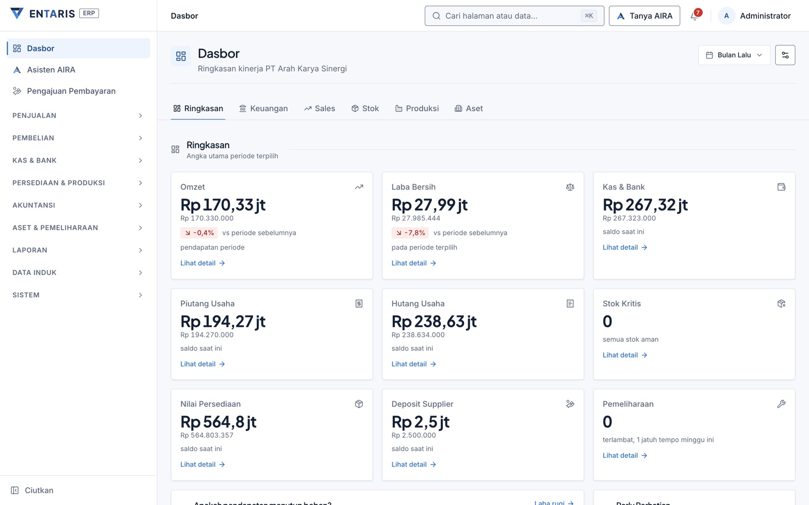
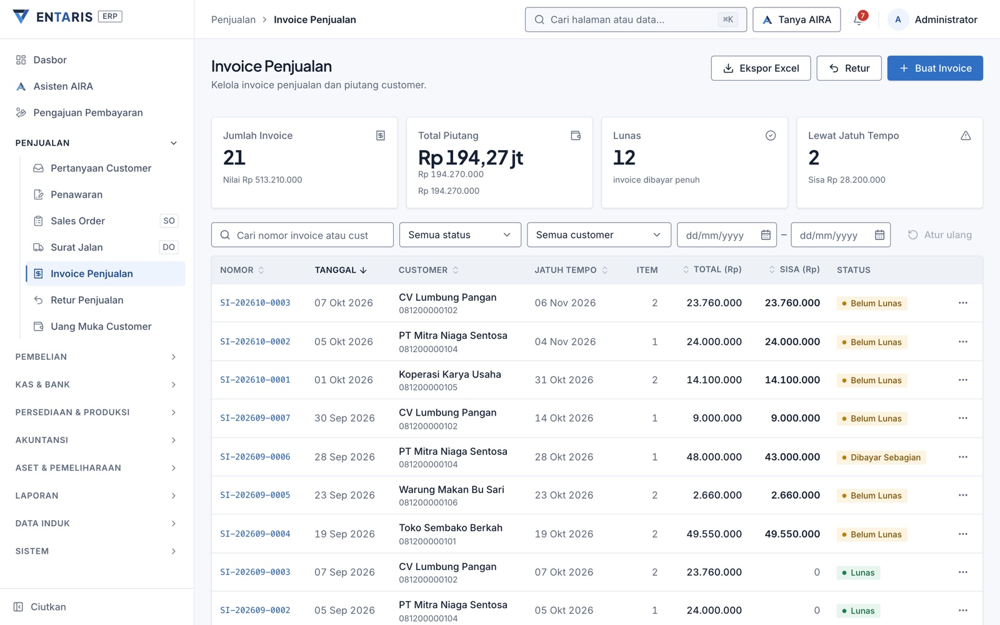
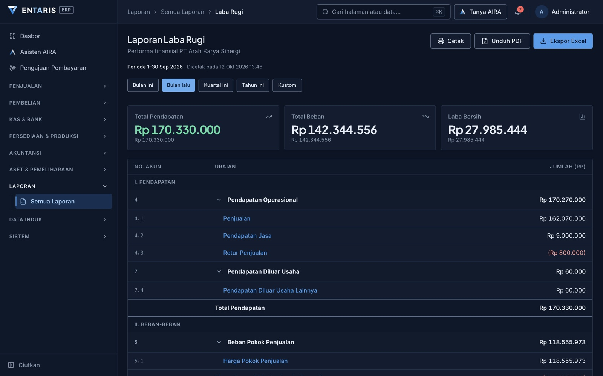
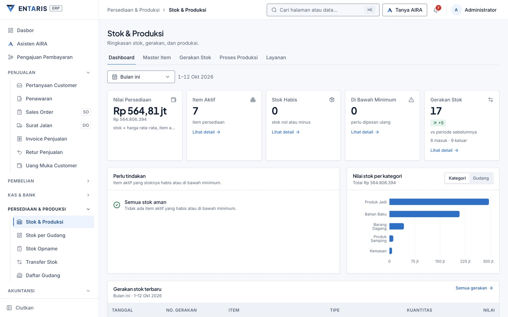
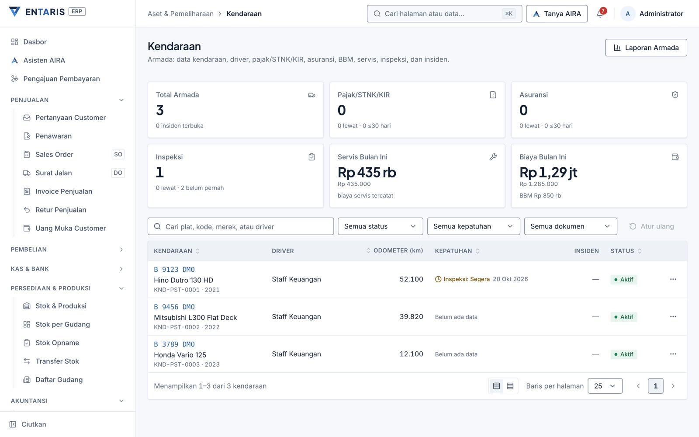
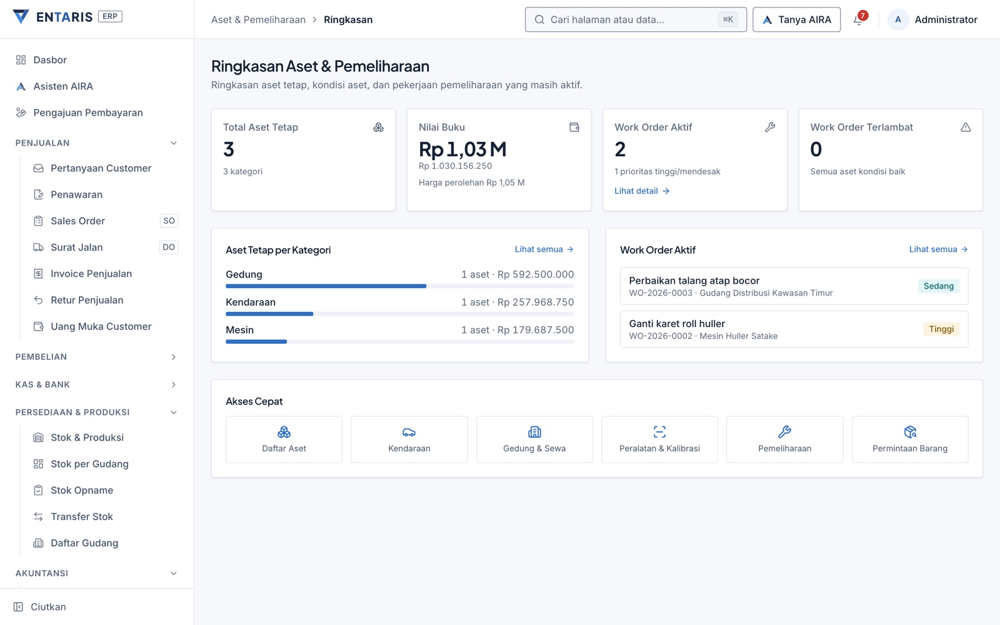

<div align="center">


# Entaris

### Agentic Reasoning System

ERP untuk penjualan, pembelian, inventori, produksi, dan keuangan dalam satu sistem. Setiap transaksi langsung membentuk jurnal double-entry, dan agen AI bernama AIRA bisa menjawab pertanyaan serta menyiapkan draf di atas data yang sama. Dipasang di server sendiri dengan Docker.

<sub><b>ENT</b>erprise · <b>A</b>gentic · <b>R</b>easoning · <b>I</b>ntegrated · <b>S</b>ystem</sub>

[](./LICENSE)
[](mailto:solutions@arahkarya.com)

</div>

> Produk PT Arah Karya Sinergi (Arah). Panduan merek: [`docs/brand/entaris`](docs/brand/entaris/README.md).

Entaris mencatat operasional dan keuangan perusahaan di satu basis data: dari toko dengan beberapa pengguna sampai pabrik (rice mill, trading, pangan) yang butuh BOM, konversi produksi, HPP, dan audit trail. Aplikasi ditulis dalam TypeScript dari ujung ke ujung (React, Express, Prisma, PostgreSQL) dan berjalan di server Anda sendiri lewat Docker Compose.

## Yang membedakan

Setiap dokumen yang berefek keuangan (invoice, pembayaran, jurnal, penerimaan barang, produksi, mutasi stok) memposting jurnalnya sendiri ke Buku Besar, dan server menolak jurnal yang debit dan kreditnya tidak sama. Laporan dibaca dari ledger yang sama, jadi angka dashboard bisa ditelusuri sampai ke dokumen sumbernya.

Aplikasi dan database berjalan di infrastruktur Anda (Raspberry Pi 5, VPS, atau server kantor). AIRA bersifat opsional: kalau diaktifkan, pertanyaan pengguna dan hasil tool yang diperlukan untuk menjawab dikirim ke engine AIRA dan penyedia model bahasa yang dipakai engine tersebut.

Fitur dinyalakan sesuai kebutuhan dengan skema yang sama, misalnya toko kecil tanpa modul produksi, lalu pabrik dengan multi-gudang, pajak per item, dan HPP produksi.

Cocok untuk:

- UKM dan toko yang ingin lepas dari Excel atau buku tulis
- Distributor dan trading dengan banyak pemasok, pelanggan, dan invoice outstanding
- Manufaktur (rice mill, pangan, pupuk, produk industri) yang butuh BOM, konversi produksi, dan HPP
- Kantor akuntan atau konsultan yang ingin menyimpan pembukuan klien di server sendiri

## Tampilan

Data pada gambar berasal dari fitur **Data Uji Coba** (Pengaturan → Cadangan & Pemulihan): tiga bulan transaksi contoh sebuah pabrik beras dan distributor, dibuat lewat alur aplikasi yang sama dengan pengguna.

| | |
|---|---|
|  |  |
| Dasbor ringkasan per periode | Invoice penjualan dan piutang |
|  |  |
| Laporan laba rugi (mode gelap) | Stok dan produksi |
|  |  |
| Armada kendaraan | Aset dan pemeliharaan |

## AIRA, agen AI di Entaris

AIRA bekerja di atas data transaksi yang sama dengan modul lain, bukan salinan, sehingga jawabannya mengikuti buku besar saat itu.

- Menjawab pertanyaan data, misalnya "berapa piutang yang lewat 60 hari?" atau "stok beras mana yang di bawah minimum?". AIRA memanggil tool ERP yang sesuai lalu merangkum hasilnya.
- Menyiapkan draf invoice, jurnal, atau pengajuan. Aksi yang mengubah pembukuan masuk ke alur persetujuan dan baru berefek setelah disetujui orang.
- Memakai hak akses pengguna yang sedang dilayani: tool yang tidak diizinkan untuk perannya tidak bisa dipanggil.
- Terhubung lewat satu server MCP (`/mcp`). Setiap panggilan membawa token profil dan *actor assertion* bertanda tangan HMAC-SHA256 (berlaku 120 detik, nonce sekali pakai) yang menyebut pengguna yang dilayani. Hak akses dan tingkat persetujuan ditegakkan oleh Entaris sendiri.
- Seluruh tool terdaftar di `server/src/ai/aira-tool-router.json` beserta tingkat risiko, peran, dan level otonominya. Katalog yang bisa dibaca orang ada di [`docs/ai-tools`](docs/ai-tools/INDEX.md).

## Arsitektur

```
docker compose up -d
         │
         ├── db  (postgres:16-alpine)
         │    ├── Port: 5432 (internal)
         │    ├── Volume: pgdata → /var/lib/postgresql/data
         │    └── Healthcheck: pg_isready
         │
         └── app (custom build dari Dockerfile)
              ├── Port: 3001 → host
              ├── Auto-migrate Prisma saat startup
              ├── Auto-seed jika database kosong
              └── Serve: Express API + React SPA
```

Urutan saat `docker compose up --build`:

1. Container `db` menyala dan PostgreSQL siap.
2. Container `app` menunggu `db` sehat.
3. Migrasi Prisma dijalankan, lalu migrasi SQL lepas yang belum tercatat.
4. Jika tabel user masih kosong, seed dijalankan (bagan akun, user admin, tahun fiskal).
5. Express menyala di port 3001 dan melayani API sekaligus React SPA.

## Fitur

Semua modul memakai satu basis data dan memposting ke Buku Besar yang sama, sehingga dashboard dan laporan selalu bisa dicocokkan dengan transaksi sumber.

### 1. Akuntansi inti

- Bagan Akun (Chart of Accounts) hierarkis tanpa batas level, dengan *rootType* (Asset, Liability, Equity, Revenue, Expense) yang menentukan perilaku debit/kredit. Import dan export Excel beserta saldo awal.
- Buku Besar double-entry: setiap transaksi menghasilkan pasangan jurnal yang seimbang. Filter periode, preset cepat (Hari Ini, Minggu, Bulan, YTD), dan opsi menyembunyikan transaksi yang dibatalkan.
- Jurnal Umum untuk penyesuaian manual multi-baris. Total debit dan kredit divalidasi sebelum posting; jurnal bisa dibatalkan dan dibalik dengan jejak lengkap.
- Akun Sistem yang bisa dipetakan sekali untuk piutang, hutang, persediaan, kas/bank, PPN, HPP, deposit, penyusutan, laba berjalan, laba ditahan, dan lainnya. Nomor akun bisa diganti tanpa mengubah kode.
- Saldo akun dihitung dari ledger (`accounting_ledger_entries`). Cache saldo bisa dihitung ulang kapan saja dan tidak dipakai sebagai acuan audit.
- Tahun Fiskal multi-periode dengan tutup buku akhir tahun yang memindahkan laba berjalan ke laba ditahan dan menutup akun nominal.

### 2. Penjualan dan piutang

Alurnya tersambung dari pertanyaan calon customer sampai pelunasan invoice.

- Inquiry: catatan pertanyaan calon customer sebelum penawaran resmi. Status Baru, Diproses, lalu Dikonversi, Hilang, atau Ditutup; sumber (WhatsApp, Telepon, Email, Walk-in, Referral); item bebas atau terstruktur; Party dibuat saat dikonversi ke Penawaran.
- Formulir publik `/tanya` untuk customer mengisi sendiri, langsung masuk ke pipeline. Tampil baik di ponsel, memakai logo perusahaan, dilindungi honeypot dan rate limit. Ada pembuat QR Code untuk dibagikan lewat WA, bio IG, brosur, atau kartu nama, lengkap dengan pelacakan sumber.
- Penawaran (Quotation) dengan status Draft, Sent, Accepted, Rejected, Expired. Penawaran kedaluwarsa ditandai otomatis tiap jam, notifikasi dikirim 3 hari sebelumnya. PDF "Penawaran Harga" memuat masa berlaku, status, tanda tangan, dan keterangan "Bukan Faktur Resmi". Bisa dikonversi ke Invoice Penjualan.
- Pesanan Penjualan (SO) dan Surat Jalan (DO). DO resmi memotong stok dan mengunci HPP saat terbit; PDF DO memuat kolom tanda tangan verifikasi fisik oleh security.
- Surat Jalan Sementara (SJS) untuk barang yang dikirim sebelum produksinya diinput. SJS tidak memotong stok, tidak membuat jurnal, dan tidak bisa ditagih. Setelah produksi selesai, SJS ditautkan ke DO resmi (saat membuat DO, dari SO, atau ke DO yang sudah ada), dan qty DO boleh berbeda. DO dibatalkan maka SJS kembali Terbuka. Ada pengingat untuk SJS yang belum ditautkan lebih dari 7 hari dan PDF "Surat Jalan Sementara".
- Invoice Penjualan per item dengan PPN per baris, diskon per item maupun global, biaya tambahan (ongkir, packing), nomor referensi PO atau penawaran customer, dan posting `DR Piutang / CR Penjualan`. Invoice bernilai Rp 0 (sumbangan, sampel, diskon 100%) langsung berstatus Paid tanpa jurnal piutang dan tetap bisa dibatalkan.
- Retur Penjualan. Retur atas invoice yang sudah lunas menjadi kredit pelanggan (uang muka), dan saldo deposit ikut tersinkron saat submit maupun batal. Retur qty saja (tarif 0, misalnya barang titipan) juga didukung.
- Penerimaan Pembayaran dengan alokasi FIFO ke invoice outstanding, termasuk satu transfer untuk beberapa invoice, pembayaran sebagian, dan refund uang muka.
- Deposit Pelanggan (uang muka) yang dipakai saat realisasi invoice.
- Aging Piutang dalam kelompok 0-30, 31-60, 61-90, dan di atas 90 hari, beserta jadwal piutang jatuh tempo untuk penagihan.
- Pembatalan invoice membalik posting GL tanpa perlu jurnal koreksi manual.
- Export Excel daftar invoice satu baris per item, termasuk kolom kualitas dan timbangan untuk pembelian.

### 3. Pembelian dan hutang

- Invoice Pembelian per item dengan PPN masukan per baris, biaya lain, dan posting `DR Persediaan (atau Beban) / CR Hutang`. Satu invoice bisa menagih beberapa STT/BPB sekaligus; mode "dari STT" menghitung harga per kg dari total invoice dibagi qty STT.
- STT/BPB (Penerimaan Barang) dengan pengaman WAC: harga satuan 0 ditolak untuk barang milik sendiri (barang titipan pelanggan dikecualikan). Edit atau batal per baris mutasi diblokir; pembatalan dan revisi dilakukan dari halaman STT agar jurnal GRNI ikut terbalik.
- Pengajuan invoice pembelian oleh staf non-admin menampilkan konteks untuk penyetuju: STT terkait, lampiran, hutang dan deposit pemasok, harga pembelian sebelumnya, serta pengecekan qty terhadap STT (memperhitungkan refaksi).
- Pembayaran ke Supplier dengan alokasi otomatis, pembayaran gabungan, dan deposit untuk pembelian yang dibayar di muka.
- Aging Hutang dan jadwal hutang jatuh tempo untuk perencanaan kas keluar.
- Pembatalan invoice membalik posting ke persediaan, hutang, dan PPN masukan.

### 4. Bank, kas, dan rekonsiliasi

- Kas dan bank multi-akun (kas kecil, kas besar, BRI, Mandiri, BCA, dan lainnya), masing-masing dengan saldo berjalan.
- Rekonsiliasi Bank: unggah mutasi bank (CSV atau Excel), cocokkan dengan transaksi di buku, tandai *matched*, *outstanding*, atau *bank-only*, dan hitung saldo rekonsiliasi.
- Transfer antar kas dan bank dengan jurnal double-entry.
- Transaksi Bank/Kas menggabungkan pembayaran dan jurnal manual (biaya administrasi bank, bunga, pindah buku); setiap baris bisa dibuka ke detail jurnalnya.
- Tagihan EAM, tab di Pengajuan Pembayaran (dulu bernama Tagihan Aset & Umum): antrian tagihan dari modul EAM (pajak/STNK/KIR, riwayat servis, permintaan barang) yang diposting Keuangan sebagai jurnal langsung (DR beban / CR kas) atau faktur pembelian (hutang). Satu tagihan satu jurnal, dan posting bisa dibatalkan. Akun default pajak kendaraan: 6.41 Beban Pajak & Perizinan Kendaraan.

### 5. Stok dan produksi

- Inventori multi-item dengan *moving average cost* untuk HPP.
- Mutasi Stok masuk dan keluar manual, dengan posting GL ke persediaan dan HPP.
- Stock Opname dengan selisih yang diposting sebagai penyesuaian persediaan. Nilai per satuan bisa diinput manual, dan submit tidak terhalang item minus historis yang tidak disentuh.
- Produksi dengan pola konversi bahan baku menjadi produk jadi dan produk samping (contoh rice mill: gabah menjadi beras, sekam, dan dedak), termasuk rendemen dan HPP. Detail produksi menampilkan modal bahan baku murni (WAC2), tersedia laporan Modal Produksi per Periode, dan jurnal revisi terbaru (`-R1`, `-R2`) ditampilkan di detail.
- Biaya konversi produksi dikreditkan ke akun 5.12 Biaya Konversi Dibebankan ke Persediaan, terpisah dari 5.1 HPP, sehingga HPP di laporan hanya memuat barang yang benar-benar terjual.
- Antrian koreksi HPP (COGS backfill). Saat barang keluar sebelum produksinya tercatat (stok sementara minus), selisih HPP diselesaikan begitu produksi atau pembelian masuk. Membatalkan atau mengubah dokumen pemicu (produksi, invoice pembelian, mutasi manual) membalik penyelesaian itu, termasuk jurnal dan antriannya.
- Barang titipan pelanggan (misalnya beras maklon) dicatat sebagai stok tanpa jurnal, dan HPP produk jadi tidak ikut memuat bahan titipan.
- Import saldo awal lewat Excel untuk migrasi dari sistem lama.

### 6. Aset tetap dan penyusutan

- Register Aset Tetap dengan kategori, tanggal perolehan, metode garis lurus, masa manfaat, dan nilai residu.
- Penyusutan bulanan dengan jurnal ke akun beban penyusutan dan akumulasi penyusutan.
- Pelepasan aset (penjualan atau penghapusan) dengan perhitungan untung atau rugi pelepasan.

### 6.1 EAM: Aset dan Pemeliharaan

EAM adalah modul di aplikasi utama, bukan aplikasi atau subdomain terpisah: satu frontend, satu backend, satu database, satu login. Staf lapangan (mekanik, GA) cukup diberi peran yang hanya membuka modul aset lewat matriks Hak Akses, tanpa akses ke menu keuangan.

- Dashboard: total aset, nilai buku (NBV), work order aktif dan terlambat, nilai per kategori, dan tautan ke tiap modul.
- Halaman per kategori aset: Kendaraan, Gedung & Sewa, Equipment & Kalibrasi, Inventaris GA, Dokumen & Sertifikat, Maintenance/Work Order, Permintaan Barang, Master Data. Tiap halaman terfilter ke kategorinya (`?categoryId=` multi-nilai di API, tetap kompatibel dengan ERP utama).
- QR aset publik bisa dibuka tanpa login (scan label aset fisik).
- Pengajuan servis dan pajak/STNK/KIR dari pilihan kendaraan, dengan pemantauan status. Pengajuan servis yang disetujui membuat Work Order, dan menutup WO mencatat riwayat servis kendaraan.
- Maintenance/Work Order dengan foto, checklist, dan suku cadang. Permintaan Barang (MR) menautkan WO, MR, persetujuan, penerimaan (stok GA bertambah), dan pembayaran. Rekap WO bisa diexport ke Excel.
- Inventaris GA dengan foto per item, tab dashboard stok, tab Tools (opname cepat, export CSV), dan peringatan lokasi gudang kosong.

#### 6.1.1 Kendaraan (Fleet)

- Data kendaraan (plat, merek, tipe, nomor mesin dan rangka, BBM, kapasitas tangki, odometer) beserta driver atau PIC.
- Pajak, STNK/KIR, dan asuransi dengan lampiran dokumen dan pengingat jatuh tempo.
- Log BBM, pemantauan ban per posisi (nomor seri), dan log ganti oli dengan target odometer berikutnya.
- Inspeksi berkala: checklist 33 sub-item dalam 6 kategori (Mesin & Cairan, Kelistrikan, Rem & Kemudi, Ban & Roda, Keselamatan, Lain-lain), tiga status per sub-item (OK, Perlu Perhatian, Rusak), foto bukti per kategori, nama inspektor, level BBM, dan jadwal inspeksi berikutnya (default 30 hari) dengan pengingat serta KPI armada "Inspeksi Jatuh Tempo". Riwayat inspeksi format lama tetap terbaca.
- Insiden dan kecelakaan, riwayat servis, pengajuan servis dengan persetujuan, dan Report Kendaraan (biaya dan kepatuhan per armada).

### 7. Laporan

Laporan utama mendukung *drill-down*: klik angka untuk membuka transaksi sumbernya.

- Trial Balance per tanggal
- Laba/Rugi untuk periode bebas, dibandingkan dengan periode sebelumnya, dirinci per kategori pendapatan dan beban
- Neraca per tanggal cut-off, termasuk ekuitas dan laba tahun berjalan
- Arus Kas metode langsung, pemasukan dan pengeluaran per akun kas dan bank
- Aging Piutang dan Hutang per pelanggan atau pemasok
- Jadwal Piutang dan Hutang (invoice jatuh tempo)
- Buku Besar per akun dengan saldo berjalan
- Laporan Pajak: rekap PPN keluaran dan masukan bulanan untuk SPT Masa
- Laporan HPP per periode
- Laporan Harian aktivitas operasional
- Setiap laporan bisa diexport ke PDF (dengan kop dan logo perusahaan) dan Excel

### 8. Operasional dan otomasi

- Dashboard multi-tab (Overview, Keuangan, Sales, Stok, Produksi) dengan widget yang bisa dinyalakan atau dimatikan per pengguna.
- Transaksi Berulang: template jurnal untuk beban rutin (sewa, gaji, langganan) yang dibuat terjadwal harian, mingguan, atau bulanan.
- Persetujuan berbasis aturan (per tipe dokumen dan batas nominal). Pengajuan staf ditahan sampai disetujui, dan efek ke GL atau stok baru terjadi setelah *approve*. Manajer bisa menyetujui, menolak, atau meminta revisi lewat tombol di Telegram, atau dari halaman Approval; pesannya memuat detail dan tautan ke pengajuan.
- Notifikasi (invoice jatuh tempo, stok di bawah minimum, persetujuan tertunda, hasil keputusan) di aplikasi dan di Telegram: pesan pribadi ke staf yang sudah menautkan akun (lewat `/start`), dengan salinan opsional ke grup.
- Panel AIRA untuk bertanya data dan menyiapkan draf transaksi (lihat [AIRA, agen AI di Entaris](#aira-agen-ai-di-entaris)). Aksi yang mengubah pembukuan selalu melewati persetujuan orang.
- Pencarian global (Ctrl + K) untuk mencari invoice, pelanggan, akun, dan transaksi dari halaman mana saja.
- Halaman Health Check yang memeriksa kesehatan data (saldo tidak seimbang, invoice yatim, pemetaan akun yang hilang, dan sejenisnya).

### 9. Tata kelola, keamanan, dan data

- Peran dan hak akses dinamis. Selain empat peran bawaan (Admin, Accountant, StaffProduksi, Viewer), Admin bisa membuat atau menghapus peran sendiri (misalnya Kasir, Auditor, Staf Pembelian) dan mengatur matriks izin per modul (Lihat, Edit) serta hak khusus (menyetujui pengajuan, melewati persetujuan, membatalkan atau memfinalkan dokumen, mengizinkan stok minus, mengelola hak akses) dari Pengaturan → Hak Akses. Menu, route, dan tombol mengikuti izin, dan server menegakkannya. Peran `Admin` punya akses penuh dan tidak bisa dikunci.
- Audit trail untuk setiap insert, update, dan delete, dengan user, waktu, dan nilai sesudah. Untuk dokumen utama (faktur, pembayaran dan deposit, jurnal, PO, penerimaan barang, surat jalan, SO, penawaran) dan master (party, item, COA, user, peran, pengaturan perusahaan, pajak, tahun buku, aset tetap), nilai sebelumnya juga disimpan sehingga perubahan tampil sebagai diff. Bisa difilter per user, tabel, atau periode.
- Manajemen pengguna: reset password dan nonaktifkan akun. Login dibatasi 10 percobaan gagal per IP per 15 menit.
- Sesi login memakai JWT di cookie httpOnly (berlaku 24 jam) dengan token CSRF double-submit; password di-hash bcrypt.
- Backup dan restore dari UI: unduh snapshot SQL, unggah file untuk restore, atau jadwalkan backup lewat cron di server.
- Lampiran dokumen pendukung (PDF bukti, foto nota) pada invoice atau jurnal, disimpan di volume terpisah.

### 10. Pengalaman pengguna

- Progressive Web App: bisa dipasang di desktop atau ponsel seperti aplikasi biasa.
- Mode terang, gelap, atau mengikuti sistem.
- Pintasan keyboard untuk navigasi utama, submit formulir, dan aksi umum.
- Tampilan menyesuaikan desktop, tablet, dan ponsel.
- Dua bahasa, Indonesia dan Inggris, dipilih per pengguna (default mengikuti bahasa perusahaan). PDF ikut bahasa pengguna. Kode dan komentar ditulis dalam bahasa Inggris.

## Quickstart (Docker)

### Prasyarat

- [Docker Desktop](https://www.docker.com/products/docker-desktop/) atau Docker Engine dengan Compose
- Git

### 1. Clone repository

```bash
git clone https://github.com/ArahKarya/entaris.git
cd entaris
```

### 2. Buat file `.env`

```bash
cp .env.docker.example .env
```

Edit `.env`. `JWT_SECRET` dan `POSTGRES_PASSWORD` wajib diganti:

```env
POSTGRES_USER=keuangan
POSTGRES_PASSWORD=ganti-dengan-password-kuat
POSTGRES_DB=keuangan_db
PORT=3001

# Wajib diganti. Buat dengan: openssl rand -hex 48
JWT_SECRET=ganti-dengan-secret-yang-aman

ALLOWED_ORIGINS=http://localhost:3001
```

Buat nilai acak untuk keduanya:

```bash
openssl rand -hex 48   # JWT_SECRET
openssl rand -hex 24   # POSTGRES_PASSWORD
```

### 3. Build dan jalankan

```bash
docker compose up -d --build
```

Pantau log sampai server menyala:

```bash
docker compose logs -f app
```

Baris yang perlu muncul:

```
[APP] Database connected.
[APP] Migrations complete.
[APP] Database kosong, menjalankan seed data awal...
[APP] Starting Entaris on port 3001...
Server running at http://localhost:3001
```

Pada boot pertama log juga mencetak akun admin demo hasil seed.

### 4. Buka aplikasi

```
http://localhost:3001
```

## Login default (demo)

Seed pertama membuat empat akun:

| Username / Email            | Password                   | Role          | Akses |
|-----------------------------|----------------------------|---------------|-------|
| `admin@entaris.demo`        | `Adminentaris123!dsw`      | Admin         | Semua modul, manajemen pengguna, pengaturan |
| `staff@entaris.demo`        | `Admin123!`                | Accountant    | Transaksi keuangan, invoice, jurnal, laporan |
| `produksi@entaris.demo`     | `Admin123!`                | StaffProduksi | Pembelian, stok dan produksi, pemasok (uang muka hanya baca) |
| `viewer@entaris.demo`       | `Admin123!`                | Viewer        | Semua data, hanya baca |

Kolom login menerima email atau username (misalnya `admin` tanpa domain).

> Ganti password default segera setelah login pertama di production, lewat menu pengguna di header → "Ganti Password" atau lewat Onboarding Wizard.

## Perintah Docker harian

```bash
# Start / stop / restart
docker compose up -d
docker compose down
docker compose restart

# Lihat log
docker compose logs -f app
docker compose logs -f db

# Status container
docker compose ps
```

### Update aplikasi

Untuk production, pakai tag rilis, bukan `main`:

```bash
bash scripts/backup.sh           # wajib sebelum update
git fetch --tags
git checkout vX.Y.Z              # lihat GitHub Releases
docker compose up -d --build
```

Data tersimpan di volume Docker `pgdata` dan tidak terhapus saat rebuild. Migrasi berjalan otomatis saat container menyala. Prosedur update lengkap, kebijakan semver, dan penanganan breaking change ada di [MIGRATION.md](./MIGRATION.md).

### Backup database

```bash
# Lewat command line
docker compose exec db pg_dump -U keuangan keuangan_db > backup-$(date +%Y%m%d).sql

# Atau lewat UI: Pengaturan → tab Backup → "Buat Backup Sekarang"
```

### Restore database

```bash
# Lewat command line
docker compose exec -T db psql -U keuangan keuangan_db < backup-20260323.sql

# Atau lewat UI: Pengaturan → tab Backup → pilih file → Restore
```

### Reset total (menghapus semua data)

```bash
docker compose down -v    # -v menghapus volume, termasuk database
docker compose up -d --build   # mulai dari awal + seed otomatis
```

## Deploy ke server atau Raspberry Pi

### Opsi 1: Docker Compose (disarankan)

```bash
git clone https://github.com/ArahKarya/entaris.git
cd entaris

cp .env.docker.example .env
nano .env   # isi JWT_SECRET, POSTGRES_PASSWORD, dan ALLOWED_ORIGINS

docker compose up -d --build
```

### Opsi 2: Cloudflare Tunnel

```bash
# .env
ALLOWED_ORIGINS=http://localhost:3001,https://erp.perusahaan-anda.com

docker compose up -d --build

# Terminal terpisah
cloudflared tunnel --url http://localhost:3001
```

### Opsi 3: Reverse proxy (Nginx)

```nginx
server {
    listen 80;
    server_name erp.perusahaan-anda.com;

    location / {
        proxy_pass http://localhost:3001;
        proxy_set_header Host $host;
        proxy_set_header X-Real-IP $remote_addr;
        proxy_set_header X-Forwarded-For $proxy_add_x_forwarded_for;
        proxy_set_header X-Forwarded-Proto $scheme;
    }
}
```

## Akun Sistem (System Account Roles)

Akun berikut dipakai sistem untuk posting GL otomatis. Semuanya bisa dipetakan ulang di Pengaturan > Akun Sistem tanpa mengubah kode, sehingga bagan akun bisa disesuaikan dengan jenis usaha.

| Grup | Role | Default COA | Fungsi |
|---|---|---|---|
| Kas & Bank | CASH (multi) | 1.1.1–1.1.5 | Akun kas/bank untuk pembayaran |
| Piutang & Hutang | AR, AP | 1.2.1, 2.1.1 | Posting invoice |
| | ALLOWANCE_DOUBTFUL | 1.2.5 | Cadangan kerugian piutang |
| | BAD_DEBT_EXPENSE | 6.27 | Beban piutang tak tertagih |
| Persediaan & HPP | INVENTORY, COGS | 1.4.0, 5 | Persediaan & HPP |
| Pendapatan | SALES, SERVICE_REVENUE | 4.1, 4.2 | Pendapatan penjualan & jasa |
| | SALES_DISCOUNT, SALES_RETURN | 4.4, 4.3 | Contra revenue |
| Pajak | TAX_INPUT, TAX_OUTPUT | 1.5.3, 2.2.1 | PPN Masukan & Keluaran |
| | INCOME_TAX_EXPENSE | 6.17 | Beban PPh Badan |
| Deposit | VENDOR_DEPOSIT, CUSTOMER_DEPOSIT | 1.3, 2.1.2 | Uang muka pemasok/pelanggan |
| Aset Tetap | FIXED_ASSET (multi) | 1.6.1–1.6.5 | Aset tetap per kategori |
| | ACCUM_DEPRECIATION (multi) | 1.7.1–1.7.4 | Akumulasi penyusutan |
| | DEPRECIATION_EXPENSE (multi) | 6.21–6.24 | Beban penyusutan |
| Bank & Bunga | BANK_CHARGE, INTEREST_EXPENSE | 8.2, 8.1 | Biaya bank & bunga pinjaman |
| | INTEREST_INCOME | 7.1 | Pendapatan bunga |
| Selisih Kurs | FX_GAIN_LOSS, FX_UNREALIZED | 8.4, 8.5 | Laba/rugi kurs |
| Akrual | PREPAID_EXPENSE (multi) | 1.5.1–1.5.2 | Biaya dibayar di muka |
| | ACCRUED_EXPENSE | 2.2.6 | Hutang beban akrual |
| Lain-lain | OTHER_INCOME, OTHER_EXPENSE | 7.4, 8.7 | Pendapatan/beban non-operasional |
| | SHIPPING_EXPENSE | 6.14 | Beban pengiriman |
| | ROUNDING_ACCOUNT | 8.8 | Pembulatan & selisih |
| Ekuitas | OPENING_EQUITY, RETAINED_EARNINGS | 3.1, 3.2 | Saldo awal & laba ditahan |
| | CURRENT_PROFIT, OWNER_DRAWING | 3.4, 3.5 | Laba berjalan & prive |

## Troubleshooting

### Aplikasi tidak menyala atau terus restart

```bash
docker compose logs app    # lihat pesan error
```

Penyebab umum:
- `JWT_SECRET is still set to the placeholder value`: ganti `JWT_SECRET` di `.env`.
- `Database connection refused`: pastikan container `db` berjalan (`docker compose ps`).
- Port 3001 sudah dipakai: ubah `PORT=3002` di `.env`.

### Lupa password admin

Ganti `PasswordBaru123!` dengan password baru, lalu jalankan:

```bash
docker compose exec app node -e "
  const bcrypt = require('bcrypt');
  const { Pool } = require('pg');
  const pool = new Pool({ connectionString: process.env.DATABASE_URL });
  bcrypt.hash('PasswordBaru123!', 12)
    .then(hash => pool.query('UPDATE users SET password_hash = \$1 WHERE email = \$2', [hash, 'admin@entaris.demo']))
    .then(r => { console.log(r.rowCount ? 'Password direset.' : 'User tidak ditemukan.'); return pool.end(); });
"
```

### Database penuh atau lambat

```bash
# Cek ukuran database
docker compose exec db psql -U keuangan -c "SELECT pg_size_pretty(pg_database_size('keuangan_db'));"

# Vacuum (optimasi)
docker compose exec db psql -U keuangan -c "VACUUM ANALYZE;"
```

### Upgrade dari versi lama

Ikuti langkah [Update aplikasi](#update-aplikasi): backup dulu, lalu pindah ke tag rilis yang dituju. Migrasi database berjalan otomatis saat container menyala.

## Development (tanpa Docker)

```bash
# 1. Jalankan PostgreSQL lewat Docker (database saja)
docker compose up -d db

# 2. Server
cd server
cp .env.example .env    # sesuaikan DATABASE_URL
npm install
npm run prisma:migrate
npx prisma db seed
npm run dev             # http://localhost:3001

# 3. Client (terminal terpisah)
cd client
npm install
npm run dev             # http://localhost:5173
```

### Script lain

```bash
# Server
npm run build            # compile TypeScript
npm run test             # unit test Vitest
npm run prisma:generate  # bangkitkan ulang Prisma client

# Client
npm run build            # build production Vite
npm run lint             # ESLint
```

## Status

- [x] Akuntansi inti: COA, Buku Besar double-entry, Jurnal Umum, Akun Sistem, tahun fiskal
- [x] Penjualan dan piutang: Inquiry, Penawaran, Invoice, pembayaran FIFO, aging, deposit
- [x] Pembelian dan hutang: Invoice, pembayaran pemasok, aging, pembatalan yang membalik jurnal
- [x] Bank, kas, dan rekonsiliasi: multi-akun, rekonsiliasi, transfer
- [x] Stok dan produksi: moving average cost, stock opname, konversi dan rendemen
- [x] Aset tetap dan penyusutan otomatis
- [x] Laporan keuangan dengan drill-down dan export PDF/Excel
- [x] Persetujuan dan notifikasi Telegram (approve/reject dari chat)
- [x] AIRA lewat server MCP, dengan RBAC dan persetujuan manusia
- [x] Peran dan hak akses dinamis (peran custom dan matriks izin per modul)
- [x] Surat Jalan Sementara, tautan ke DO resmi, invoice Rp 0 langsung Paid
- [x] Pembalikan otomatis penyelesaian HPP saat dokumen pemicu dibatalkan atau diubah
- [x] EAM di aplikasi utama (kendaraan, WO, MR, inventaris GA) dan Tagihan EAM ke keuangan
- [x] Audit trail, backup/restore dari UI, PWA, mode gelap, dua bahasa (ID/EN)
- [x] Self-hosted dengan Docker Compose, migrasi dan seed otomatis
- [ ] Multi-currency penuh (akun laba/rugi kurs sudah ada, UI multi-currency menyusul)

Di luar cakupan: HRD dan payroll, yang ditangani aplikasi HRIS terpisah.

## Stack

- Frontend: React 19, TypeScript 5.9, Vite 7, Tailwind CSS 4, TanStack Query 5, i18next, Recharts, @react-pdf/renderer, Sonner, Lucide
- Backend: Node.js 20, Express 5, TypeScript 5.9, Prisma 7, Zod, Pino, JWT, bcrypt, helmet, express-rate-limit
- Database: PostgreSQL 16
- Auth: JWT di cookie httpOnly dengan token CSRF, peran dan matriks izin yang diatur dari UI
- Testing: Vitest (unit dan integrasi), Playwright (E2E)
- AI: AIRA sebagai klien server MCP Entaris (`/mcp`), engine terpisah dari aplikasi
- Deploy: Docker Compose (2 container: `app` dan `db`)

## Lisensi

Proprietary. © 2026 PT Arah Karya Sinergi. Seluruh hak dilindungi.

Entaris hanya boleh digunakan, disalin, atau dimodifikasi berdasarkan perjanjian lisensi tertulis dengan PT Arah Karya Sinergi. Lihat [`LICENSE`](./LICENSE). Untuk lisensi, harga, dan demo: solutions@arahkarya.com.

---

<div align="center">

<br />
<sub><b>Entaris</b> · Agentic Reasoning System · © 2026 PT Arah Karya Sinergi (Arah)</sub>
</div>
