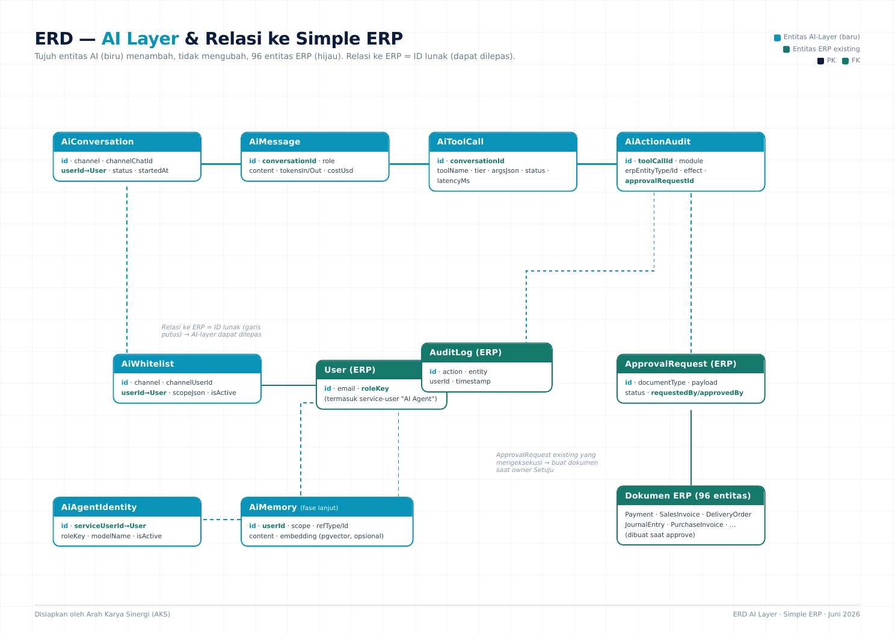

# Dokumen Teknis: ERD & AI Layer untuk Entaris — Fungsi ERP Lengkap

**Produk:** Lapisan AI Agentic (AI Resident Assistant) untuk Entaris — ArahKarya
**Arsitektur:** Hermes Agent sebagai engine + ERP Tool API + model Claude Opus via 9router
**Cakupan:** SELURUH 35 modul ERP (250+ endpoint, 96 entitas)
**Disiapkan oleh:** Arah Karya Sinergi (AKS)
**Tanggal:** 23 Juni 2026 · **Versi:** 1.0 (Highest-Effort / ERP-wide)

---

# BAGIAN A — KONTEKS & STRATEGI

## A1. Ringkasan Eksekutif

Dokumen ini adalah **blueprint engineering** untuk membangun lapisan AI agentic di atas Entaris — bukan
proof-of-concept satu fitur, melainkan rancangan menyeluruh yang memetakan **seluruh 35 modul ERP** ke
kemampuan AI (membaca data, menyiapkan draf dokumen, dan mengeksekusi transaksi dengan persetujuan manusia).

Inti dokumen:
1. **ERD Layer AI** — tujuh entitas data baru yang menjadi tulang punggung AI (percakapan, pesan, tool-call,
   audit aksi, whitelist, identitas agen, memori) beserta relasinya ke 96 entitas ERP yang sudah ada.
2. **Pemetaan fungsi ERP lengkap** — katalog tool agentic untuk tiap modul (READ / DRAFT / ACTION) lengkap
   dengan tingkat izin (tier), dipetakan ke endpoint dan service nyata di kode.
3. **Arsitektur & keamanan** — Hermes sebagai engine, kanal WhatsApp (informasi) + Telegram (persetujuan),
   model izin dua-lapis, dan jejak audit penuh untuk setiap aksi AI.

Temuan kunci dari audit kode: **fondasi agentic sudah ~80% tersedia.** ERP telah memiliki RBAC dinamis,
mekanisme `ApprovalRequest` dengan pola *approve-before-effect*, service submit/cancel terbungkus per dokumen,
audit trail, double-entry otomatis, dan integrasi Telegram. Lapisan AI tidak membangun ulang logika bisnis —
ia **memanggil fondasi yang sudah teruji** melalui Tool API tipis.

## A2. Latar Belakang — Realita Kode (hasil audit)

Seluruh dokumen ini dibangun di atas audit kode nyata, bukan asumsi. Ringkasan temuan:

| Aspek | Temuan terverifikasi |
|---|---|
| Route files | 49 file (`server/src/routes/`) |
| Endpoint REST | ~250 |
| Service terbungkus | 30+ (submit/cancel/edit/revise per dokumen) |
| Model Prisma (entitas) | **96** (schema 2.662 baris) |
| Modul RBAC | **35 modul** dalam 8 grup |
| Capability sensitif | 6 (`doc.cancel`, `approval.decide`, `approval.bypass`, `approval.view_all`, `inventory.negative_stock`, `rbac.manage`) |
| Approval gate | `ApprovalRequest` — payload JSON, dokumen dibuat saat approve |
| RBAC | Dinamis: Role × Module → view/edit + capabilities |
| Double-entry | Otomatis di setiap transaksi (GL balanced) |
| Audit trail | `AuditLog` middleware di semua mutasi |
| Integrasi pesan | `telegramService.ts` (395 baris) sudah ada |
| Lib AI/LLM | **Belum ada** — greenfield bersih |

### Cakupan domain ERP (lebih luas dari ERP dagang biasa)

| Grup | Modul | Catatan |
|---|---|---|
| Penjualan | SO, DO, Invoice, Quotation/Inquiry, Retur, Uang Muka Pelanggan | Rantai Quotation→SO→DO→Invoice |
| Pembelian | PO, Penerimaan (BPB/STT), Invoice Beli, Uang Muka Vendor | Rantai PO→GR→PI→Payment |
| Stok & Produksi | Stok/Gudang, Transfer, Opname, **Produksi**, Daftar Gudang | Produksi: Machine, ProductionRun, OEE, downtime |
| Bank & Kas | Transaksi Bank/Kas, Rekonsiliasi, Berulang, Jaminan Proyek | **Pilot pertama di sini** |
| Akuntansi | COA, Jurnal/Buku Besar, Aset Tetap, Approval | Double-entry, depresiasi |
| EAM (General Affairs) | Aset, Kendaraan, Gedung & Sewa, Equipment & Kalibrasi, Maintenance & Work Order, Inventaris, Dokumen Legal, Master Data | 40+ entitas `Ga*` |
| Laporan | Semua laporan keuangan & operasional | Jadi tool READ |
| Master & Sistem | Pelanggan & Vendor, Pengaturan, User, Audit | |

## A3. Visi — dari Pilot Bank ke ERP-wide Agentic

Pendekatan bertahap: mulai dari **pencatatan bank** (use-case pilot, tier berisiko tinggi tapi terbungkus rapi),
lalu meluas ke modul read-only (laporan, query stok/piutang), kemudian modul transaksional (penjualan,
pembelian), dan akhirnya EAM/GA. Setiap fase menambah tool ke katalog yang sama tanpa membangun ulang engine.

**Tujuan akhir:** staf cukup berbicara natural ("buatkan invoice untuk PO-123", "berapa piutang jatuh tempo
minggu ini", "catat transfer masuk 50 juta dari PT X") di kanal chat, dan AI menyiapkan + mengeksekusi
(dengan persetujuan) di ERP — sambil setiap langkah tercatat dan dapat diaudit.

## A4. Prinsip Desain (tidak bisa ditawar)

1. **Agen tidak menulis database secara langsung.** Semua mutasi lewat service ERP yang sudah ada
   (`salesInvoiceSubmit`, `paymentSubmit`, dll) — menjaga integritas double-entry, stok, dan validasi.
2. **Izin dua-lapis.** Agen mengecek izin sebelum memanggil tool, DAN backend mengecek ulang izin saat
   tool dijalankan. Mencegah prompt-injection memaksa aksi di luar wewenang.
3. **Approve-before-effect untuk aksi berdampak.** Re-use `ApprovalRequest`: aksi finansial/berisiko tidak
   langsung jadi — disimpan sebagai draf, dieksekusi hanya setelah owner menyetujui via Telegram.
4. **Identitas AI jelas.** Setiap aksi yang diinput AI tercatat atas nama service-user khusus "AI Agent",
   sehingga laporan dapat memfilter "diinput AI vs manusia".
5. **Audit penuh.** Setiap percakapan, tool-call, dan aksi tercatat di entitas AI-layer (lihat Bagian B)
   plus tetap masuk `AuditLog` ERP existing.
6. **Whitelist akses.** Hanya user yang di-whitelist (channel ID ↔ user ERP) yang boleh memerintah AI.

---

# BAGIAN B — ERD LAYER AI (Model Data Inti)

Lapisan AI memerlukan tujuh entitas baru. Semuanya berprefiks `Ai*` agar terpisah jelas dari entitas ERP.
Entitas ini **menambah**, tidak mengubah, skema ERP existing — relasi ke ERP dilakukan via foreign key lunak
(menyimpan ID + tipe, bukan FK keras) agar lapisan AI dapat dilepas tanpa merusak ERP.

## B1. Daftar Entitas AI-Layer

| Entitas | Fungsi | Volume (estimasi) |
|---|---|---|
| `AiConversation` | Sesi percakapan per kanal/user | Sedang |
| `AiMessage` | Tiap giliran (user/assistant/tool) + token & biaya | Tinggi |
| `AiToolCall` | Catatan tiap tool dipanggil: argumen, hasil, status, latensi | Tinggi |
| `AiActionAudit` | Aksi yang menyentuh ERP (dokumen dibuat/diubah, atas nama AI) | Sedang |
| `AiWhitelist` | Pemetaan channel ID ↔ user ERP ↔ scope izin | Rendah |
| `AiAgentIdentity` | Definisi service-user "AI Agent" + role khusus | Sangat rendah |
| `AiMemory` | Memori semantik per-user/per-entitas (fase lanjut) | Sedang |

## B2. Detail Field per Entitas

### AiConversation — sesi percakapan
| Field | Tipe | Keterangan |
|---|---|---|
| id | uuid (PK) | |
| channel | string | `telegram` / `whatsapp` |
| channelChatId | string | ID chat/grup sumber |
| userId | uuid (FK→User, lunak) | User ERP pemilik sesi (via whitelist) |
| title | string? | Ringkasan topik (auto) |
| status | string | `active` / `archived` |
| startedAt | datetime | |
| lastMessageAt | datetime | |

### AiMessage — giliran percakapan
| Field | Tipe | Keterangan |
|---|---|---|
| id | uuid (PK) | |
| conversationId | uuid (FK→AiConversation) | |
| role | string | `user` / `assistant` / `tool` / `system` |
| content | text | Isi pesan |
| toolCallId | uuid? (FK→AiToolCall) | Bila pesan = hasil tool |
| tokensIn / tokensOut | int | Untuk akunting biaya |
| costUsd | decimal? | Biaya token (Opus@9router) |
| createdAt | datetime | |

### AiToolCall — panggilan tool
| Field | Tipe | Keterangan |
|---|---|---|
| id | uuid (PK) | |
| conversationId | uuid (FK) | |
| toolName | string | mis. `record_bank_payment` |
| tier | string | `auto` / `draft_approve` / `must_approve` |
| argsJson | json | Argumen tool |
| resultJson | json? | Hasil (atau error) |
| status | string | `success` / `error` / `pending_approval` / `rejected` |
| latencyMs | int? | |
| createdAt | datetime | |

### AiActionAudit — jejak aksi ke ERP
| Field | Tipe | Keterangan |
|---|---|---|
| id | uuid (PK) | |
| toolCallId | uuid (FK→AiToolCall) | |
| module | string | Modul ERP (mis. `payment`) |
| erpEntityType | string | Tipe dokumen (mis. `Payment`) |
| erpEntityId | string? | ID dokumen ERP yang terpengaruh |
| approvalRequestId | uuid? (FK→ApprovalRequest, lunak) | Bila lewat approval gate |
| actedAsUserId | uuid (FK→User) | Service-user "AI Agent" |
| effect | string | `created` / `updated` / `cancelled` / `drafted` |
| createdAt | datetime | |

### AiWhitelist — kontrol akses
| Field | Tipe | Keterangan |
|---|---|---|
| id | uuid (PK) | |
| channel | string | `telegram` / `whatsapp` |
| channelUserId | string | ID user/nomor di kanal |
| userId | uuid (FK→User) | User ERP yang dipetakan |
| scopeJson | json? | Batas scope (modul/tier yang diizinkan), null = ikut role |
| isActive | boolean | |

### AiAgentIdentity — identitas agen
| Field | Tipe | Keterangan |
|---|---|---|
| id | uuid (PK) | |
| serviceUserId | uuid (FK→User) | User "AI Agent" untuk pencatatan |
| roleKey | string | Role RBAC khusus AI (scoped) |
| modelName | string | mis. `claude-opus-4` |
| isActive | boolean | |

### AiMemory — memori semantik (fase lanjut)
| Field | Tipe | Keterangan |
|---|---|---|
| id | uuid (PK) | |
| userId | uuid (FK→User) | |
| scope | string | `user` / `entity` |
| refType / refId | string? | Entitas ERP yang dirujuk |
| content | text | Fakta yang diingat |
| embedding | vector? | Untuk pencarian semantik (pgvector, opsional) |
| createdAt | datetime | |

## B3. Relasi ke ERP Existing

```
AiConversation ──< AiMessage >── AiToolCall ──< AiActionAudit
       │                                              │
       │ (lunak)                                      │ (lunak)
       ▼                                              ▼
     User ◄──────── AiWhitelist            ApprovalRequest ──► (dokumen ERP saat approve)
       ▲                                              │
       │                                              ▼
AiAgentIdentity ──► User (service "AI Agent")    AuditLog (ERP existing)
```

- **Relasi keras** hanya antar entitas `Ai*` (cascade aman).
- **Relasi ke ERP** (`User`, `ApprovalRequest`, dokumen) disimpan sebagai **ID + tipe lunak** — lapisan AI
  dapat di-drop tanpa migrasi merusak ERP.
- Saat aksi tier 🔴 disetujui, `ApprovalRequest` existing yang mengeksekusi (membuat dokumen) — `AiActionAudit`
  hanya mencatat tautannya.

## B4. Migrasi Prisma

Tujuh model `Ai*` ditambahkan ke `schema.prisma` sebagai blok terpisah. Karena DB ERP tidak meng-expose
port (pola multi-tenant), migrasi mengikuti prosedur manual existing: tulis `migration.sql` → `docker exec`
psql `CREATE TABLE` → catat `_prisma_migrations` → `prisma generate` di host. Tidak ada perubahan pada tabel
ERP existing → nol risiko regresi pada data transaksi.

<div style="page-break-before: always;"></div>

## B5. Diagram ERD Visual



*Diagram: tujuh entitas AI-layer (biru) dan relasinya ke entitas ERP existing (hijau). Garis putus = relasi ID lunak; AI-layer dapat dilepas tanpa merusak ERP.*

<div style="page-break-before: always;"></div>

# BAGIAN C — PEMETAAN FUNGSI ERP LENGKAP (35 Modul → Tool Agentic)

Setiap modul ERP dipetakan ke tiga jenis tool:
- **READ** (🟢 auto) — query data, laporan, status. Tak mengubah apa pun. Boleh langsung.
- **DRAFT** (🟡 draft) — siapkan dokumen/payload, tampilkan ke user untuk konfirmasi. Belum menyentuh DB.
- **ACTION** (🔴 approve) — submit/cancel dokumen → menyentuh GL/stok/kas. Wajib lewat approval gate.

**Tier izin:**
🟢 = boleh otomatis (read-only) · 🟡 = perlu konfirmasi user di chat · 🔴 = wajib persetujuan owner via Telegram.

Kolom "Endpoint/Service" merujuk kode nyata hasil audit — tool adalah *wrapper tipis* di atasnya.

---

## C1. Grup PENJUALAN

### Modul: Sales Order (SO)
| Tool | Jenis | Tier | Endpoint/Service ERP |
|---|---|---|---|
| `so_list` / `so_get` | READ | 🟢 | `GET /sales-orders`, `/:id` |
| `so_draft` | DRAFT | 🟡 | susun payload `POST /sales-orders` |
| `so_create` | ACTION | 🔴 | `POST /sales-orders` |
| `so_submit` | ACTION | 🔴 | `POST /sales-orders/:id/submit` |
| `so_generate_do` | ACTION | 🔴 | `POST /sales-orders/:id/generate-do` |
| `so_cancel` | ACTION | 🔴 | `POST /sales-orders/:id/cancel` (cap `doc.cancel`) |

### Modul: Delivery Order (Surat Jalan)
| Tool | Jenis | Tier | Endpoint/Service |
|---|---|---|---|
| `do_list` / `do_pending` / `do_get` | READ | 🟢 | `GET /delivery-orders`, `/pending`, `/:id` |
| `do_draft` | DRAFT | 🟡 | payload `POST /delivery-orders` |
| `do_create` | ACTION | 🔴 | `POST /delivery-orders` (`deliveryOrderSubmit`) |
| `do_from_invoice` | ACTION | 🔴 | `POST /delivery-orders/from-invoice/:invoiceId` |
| `do_cancel` | ACTION | 🔴 | `POST /delivery-orders/:id/cancel` (`deliveryOrderCancel`) |

### Modul: Sales Invoice
| Tool | Jenis | Tier | Endpoint/Service |
|---|---|---|---|
| `si_list` / `si_get` | READ | 🟢 | `GET /sales/invoices`, `/:id` |
| `si_draft` | DRAFT | 🟡 | payload `POST /sales/invoices` |
| `si_create` | ACTION | 🔴 | `POST /sales/invoices` (`salesInvoiceSubmit`) — DR Piutang / CR Penjualan |
| `si_cancel` | ACTION | 🔴 | `POST /sales/invoices/:id/cancel` (`invoiceCancellation`) |

### Modul: Quotation & Inquiry
| Tool | Jenis | Tier | Endpoint/Service |
|---|---|---|---|
| `quo_list` / `quo_get` / `quo_stats` | READ | 🟢 | `GET /quotations`, `/:id`, `/stats` |
| `quo_draft` | DRAFT | 🟡 | payload `POST /quotations` |
| `quo_create` | ACTION | 🟡 | `POST /quotations` (tak ada efek GL → tier lebih ringan) |
| `quo_send` / `quo_accept` / `quo_reject` | ACTION | 🟡 | `PATCH /quotations/:id/{send,accept,reject}` |
| `quo_convert` | ACTION | 🔴 | `GET /:id/convert-payload` → buat SO |

### Modul: Sales Return (Retur Penjualan)
| Tool | Jenis | Tier | Endpoint/Service |
|---|---|---|---|
| `sr_list` / `sr_get` | READ | 🟢 | `GET /sales-returns`, `/:id` |
| `sr_create` | ACTION | 🔴 | `POST /sales-returns` (`salesReturnSubmit`) |
| `sr_cancel` | ACTION | 🔴 | (`salesReturnCancel`) cap `doc.cancel` |

### Modul: Customer Deposit (Uang Muka Pelanggan)
| Tool | Jenis | Tier | Endpoint/Service |
|---|---|---|---|
| `cd_list` / `cd_get` | READ | 🟢 | `GET /customer-deposits` |
| `cd_create` | ACTION | 🔴 | `POST /customer-deposits` |
| `cd_apply` | ACTION | 🔴 | aplikasikan deposit ke invoice |

---

## C2. Grup PEMBELIAN

### Modul: Purchase Order (PO)
| Tool | Jenis | Tier | Endpoint/Service |
|---|---|---|---|
| `po_list` / `po_get` | READ | 🟢 | `GET /purchase-orders`, `/:id` |
| `po_draft` / `po_create` | DRAFT/ACTION | 🟡/🔴 | `POST /purchase-orders` (`purchaseOrderSubmit`) |
| `po_cancel` | ACTION | 🔴 | `POST /purchase-orders/:id/cancel` |

### Modul: Goods Receipt (BPB/STT)
| Tool | Jenis | Tier | Endpoint/Service |
|---|---|---|---|
| `gr_list` / `gr_pending` / `gr_get` | READ | 🟢 | `GET /goods-receipts`, `/pending`, `/:id` |
| `gr_create` | ACTION | 🔴 | `POST /goods-receipts` (`goodsReceiptSubmit`) — stok+accrual |
| `gr_cancel` | ACTION | 🔴 | `POST /goods-receipts/:id/cancel` |

### Modul: Purchase Invoice (PI)
| Tool | Jenis | Tier | Endpoint/Service |
|---|---|---|---|
| `pi_list` / `pi_get` | READ | 🟢 | `GET /purchase/invoices`, `/:id` |
| `pi_create` | ACTION | 🔴 | `POST /purchase/invoices` (`purchaseInvoiceSubmit`) |
| `pi_revise_price` | ACTION | 🔴 | `POST /purchase/invoices/:id/revise-price` (`purchaseInvoiceRevise`) |
| `pi_cancel` | ACTION | 🔴 | `POST /purchase/invoices/:id/cancel` |

### Modul: Vendor Deposit (Uang Muka Vendor)
| Tool | Jenis | Tier | Endpoint/Service |
|---|---|---|---|
| `vd_list` / `vd_get` | READ | 🟢 | `GET /vendor-deposits` |
| `vd_create` / `vd_apply` | ACTION | 🔴 | `POST /vendor-deposits`, aplikasi |

---

## C3. Grup STOK & PRODUKSI

### Modul: Inventory (Stok & Gudang)
| Tool | Jenis | Tier | Endpoint/Service |
|---|---|---|---|
| `inv_items` / `inv_item_get` | READ | 🟢 | `GET /inventory/items`, `/:id` |
| `inv_stock` / `inv_low_stock` | READ | 🟢 | `GET /inventory/movements`, `/low-stock` |
| `inv_item_create` / `inv_item_update` | ACTION | 🟡 | `POST/PUT /inventory/items` (master, tak ada GL) |
| `inv_movement` | ACTION | 🔴 | `POST /inventory/movements` (penyesuaian stok) |

### Modul: Stock Transfer
| Tool | Jenis | Tier | Endpoint/Service |
|---|---|---|---|
| `st_list` / `st_get` | READ | 🟢 | `GET /stock-transfers`, `/:id` |
| `st_create` | ACTION | 🔴 | `POST /stock-transfers` (`stockTransfer`) |
| `st_cancel` | ACTION | 🔴 | `PATCH /stock-transfers/:id/cancel` |

### Modul: Stock Opname
| Tool | Jenis | Tier | Endpoint/Service |
|---|---|---|---|
| `op_list` / `op_get` | READ | 🟢 | `GET /stock-opname`, `/:id` |
| `op_create` | ACTION | 🔴 | `POST /stock-opname` |
| `op_finalize` | ACTION | 🔴 | finalisasi (cap `doc.cancel`) — sesuaikan stok |

### Modul: Produksi (Manufaktur)
| Tool | Jenis | Tier | Endpoint/Service |
|---|---|---|---|
| `prod_runs` / `prod_run_get` | READ | 🟢 | `GET /production/runs`, `/:id` |
| `prod_oee` / `prod_yield` | READ | 🟢 | `GET /inventory/dashboard/oee`, `/yield-trend` |
| `prod_machines` | READ | 🟢 | `GET /inventory/machines` |
| `prod_run_create` | ACTION | 🔴 | `POST /production/runs` (`productionRunSubmit`) |
| `prod_run_cancel` | ACTION | 🔴 | (`productionRunCancel`) cap `doc.cancel` |

### Modul: Warehouse
| Tool | Jenis | Tier | Endpoint/Service |
|---|---|---|---|
| `wh_list` / `wh_get` | READ | 🟢 | `GET /warehouses`, `/:id` |
| `wh_create` / `wh_update` | ACTION | 🟡 | `POST/PUT /warehouses` (master) |

---

## C4. Grup BANK & KAS  ★ Pilot pertama

### Modul: Payment (Transaksi Bank/Kas)
| Tool | Jenis | Tier | Endpoint/Service |
|---|---|---|---|
| `pay_list` / `pay_get` | READ | 🟢 | `GET /payments`, `/:id` |
| `pay_cash_journals` | READ | 🟢 | `GET /payments/cash-journals` |
| `pay_draft_receive` | DRAFT | 🟡 | susun payload Receive (alokasi ke invoice) |
| `pay_draft_pay` | DRAFT | 🟡 | susun payload Pay (ke hutang) |
| `pay_record` | ACTION | 🔴 | `POST /payments` (`paymentSubmit`) — DR/CR Kas/Bank |
| `pay_cancel` | ACTION | 🔴 | `POST /payments/:id/cancel` |

> PaymentType: Receive / Pay / CustomerDeposit / VendorDeposit / Refund + splits (biaya admin bank) + allocations.

### Modul: Bank Reconciliation
| Tool | Jenis | Tier | Endpoint/Service |
|---|---|---|---|
| `recon_list` / `recon_get` | READ | 🟢 | `GET /reconciliation`, `/:id` |
| `recon_create` | ACTION | 🟡 | `POST /reconciliation` |
| `recon_match` / `recon_unmatch` | ACTION | 🟡 | `PATCH /reconciliation/:id/{match,unmatch}` |
| `recon_complete` | ACTION | 🔴 | `POST /reconciliation/:id/complete` |

### Modul: Recurring (Transaksi Berulang)
| Tool | Jenis | Tier | Endpoint/Service |
|---|---|---|---|
| `rec_list` / `rec_get` | READ | 🟢 | `GET /recurring` |
| `rec_create` / `rec_run` | ACTION | 🔴 | `POST /recurring` (`recurringRunner`) |

### Modul: Project Guarantee (Uang Jaminan)
| Tool | Jenis | Tier | Endpoint/Service |
|---|---|---|---|
| `pg_list` / `pg_get` | READ | 🟢 | `GET /project-guarantees` |
| `pg_create` / `pg_settle` | ACTION | 🔴 | `POST /project-guarantees`, settlement |

---

## C5. Grup AKUNTANSI

### Modul: COA (Bagan Akun)
| Tool | Jenis | Tier | Endpoint/Service |
|---|---|---|---|
| `coa_list` / `coa_flat` | READ | 🟢 | `GET /coa`, `/flat` |
| `coa_create` / `coa_update` | ACTION | 🟡 | `POST/PUT /coa` (master) |
| `coa_set_balance` | ACTION | 🔴 | `PATCH /coa/:id/balance` (saldo awal) |

### Modul: Journal (Buku Besar)
| Tool | Jenis | Tier | Endpoint/Service |
|---|---|---|---|
| `je_list` / `je_get` | READ | 🟢 | `GET /journals`, `/:id` |
| `je_draft` | DRAFT | 🟡 | susun jurnal balanced (transfer antar bank, koreksi) |
| `je_create` | ACTION | 🔴 | `POST /journals` — wajib balanced |
| `je_cancel` | ACTION | 🔴 | `PATCH /journals/:id/cancel` |

### Modul: Fixed Assets (Aset Tetap)
| Tool | Jenis | Tier | Endpoint/Service |
|---|---|---|---|
| `fa_list` / `fa_get` / `fa_categories` | READ | 🟢 | `GET /fixed-assets`, `/:id`, `/categories` |
| `fa_create` | ACTION | 🔴 | `POST /fixed-assets` |
| `fa_depreciate` | ACTION | 🔴 | jalankan depresiasi (DepreciationEntry) |

### Modul: Approval (Pengajuan)
| Tool | Jenis | Tier | Endpoint/Service |
|---|---|---|---|
| `appr_list` / `appr_get` | READ | 🟢 | `GET /approvals`, `/:id` |
| `appr_pending` | READ | 🟢 | daftar yang menunggu owner |
| (keputusan approve/reject TIDAK diberikan ke AI — selalu manusia) | — | — | — |

---

## C6. Grup EAM — General Affairs (Manajemen Aset)

### Modul: GA Assets
| Tool | Jenis | Tier | Endpoint/Service |
|---|---|---|---|
| `ga_assets` / `ga_asset_get` | READ | 🟢 | `GET /ga/assets`, `/:id` |
| `ga_asset_create` / `ga_asset_update` | ACTION | 🟡 | `POST/PUT /ga/assets` |
| `ga_asset_condition` | ACTION | 🟡 | `PATCH /ga/assets/:id/condition` |

### Modul: GA Vehicle (Kendaraan)
| Tool | Jenis | Tier | Endpoint/Service |
|---|---|---|---|
| `gv_get` / `gv_services` | READ | 🟢 | `GET /ga/vehicle/assets/:id`, `/services` |
| `gv_service_log` | ACTION | 🟡 | `POST /ga/vehicle/assets/:id/services` |
| `gv_service_request` | ACTION | 🟡 | `POST /ga/vehicle/assets/:id/service-requests` |

### Modul: GA Building (Gedung & Sewa)
| Tool | Jenis | Tier | Endpoint/Service |
|---|---|---|---|
| `gb_get` / `gb_rentals` | READ | 🟢 | `GET /ga/building/assets/:id`, `/rentals` |
| `gb_rental_create` / `gb_rental_end` | ACTION | 🟡 | `POST/PATCH /ga/building/.../rentals` |

### Modul: GA Equipment & Kalibrasi
| Tool | Jenis | Tier | Endpoint/Service |
|---|---|---|---|
| `ge_get` / `ge_calibration` | READ | 🟢 | `GET /ga/equipment/assets/:id/calibration-logs` |
| `ge_calibration_log` | ACTION | 🟡 | `POST /ga/equipment/.../calibration-logs` |

### Modul: GA Maintenance & Work Order
| Tool | Jenis | Tier | Endpoint/Service |
|---|---|---|---|
| `gm_schedules` / `gm_work_orders` | READ | 🟢 | `GET /ga/maintenance/schedules`, `/work-orders` |
| `gm_wo_create` | ACTION | 🟡 | `POST /ga/maintenance/work-orders` |
| `gm_wo_assign` / `gm_wo_start` | ACTION | 🟡 | `PATCH /ga/maintenance/work-orders/:id/{assign,start}` |

### Modul: GA Inventory (Sparepart/ATK)
| Tool | Jenis | Tier | Endpoint/Service |
|---|---|---|---|
| `gi_items` / `gi_low_stock` | READ | 🟢 | `GET /ga/inventory/items`, `/low-stock` |
| `gi_movement` | ACTION | 🟡 | `POST /ga/inventory/movements` |

### Modul: GA Documents (Legal & Sertifikat)
| Tool | Jenis | Tier | Endpoint/Service |
|---|---|---|---|
| `gd_list` / `gd_get` | READ | 🟢 | `GET /ga/documents`, `/:id` |
| `gd_create` / `gd_version` | ACTION | 🟡 | `POST /ga/documents`, `/versions` |
| `gd_expiring` | READ | 🟢 | dokumen mendekati kedaluwarsa (reminder proaktif) |

### Modul: GA Master Data
| Tool | Jenis | Tier | Endpoint/Service |
|---|---|---|---|
| `gmst_branches` / `gmst_cost_centers` | READ | 🟢 | `GET /ga/master/branches`, `/cost-centers` |
| `gmst_*_crud` | ACTION | 🟡 | master CRUD |

---

## C7. Grup LAPORAN

| Tool | Jenis | Tier | Endpoint/Service |
|---|---|---|---|
| `rpt_balance_sheet` | READ | 🟢 | `GET /reports` (neraca) |
| `rpt_income_statement` | READ | 🟢 | laba rugi |
| `rpt_general_ledger` | READ | 🟢 | buku besar |
| `rpt_ar_aging` / `rpt_ap_aging` | READ | 🟢 | umur piutang/hutang |
| `rpt_cash_flow` | READ | 🟢 | arus kas |
| `rpt_stock_valuation` | READ | 🟢 | nilai persediaan |
| `rpt_dashboard` | READ | 🟢 | `GET /dashboard/*` (14 endpoint metrik) |

> Seluruh laporan = tier 🟢 (read-only). Ini "quick win" terbesar: AI menjawab pertanyaan bisnis
> ("berapa laba bulan ini", "piutang jatuh tempo minggu depan") tanpa risiko sama sekali.

---

## C8. Grup MASTER DATA & SISTEM

### Modul: Parties (Pelanggan & Vendor)
| Tool | Jenis | Tier | Endpoint/Service |
|---|---|---|---|
| `party_search` / `party_get` | READ | 🟢 | `GET /parties`, `/similar`, `/:id` |
| `party_dashboard` | READ | 🟢 | `GET /parties/dashboard` |
| `party_create` / `party_update` | ACTION | 🟡 | `POST/PUT /parties` (master, deteksi duplikat via `/similar`) |

### Modul: Settings / Users / Audit
| Tool | Jenis | Tier | Endpoint/Service |
|---|---|---|---|
| `audit_search` | READ | 🟢 | `GET /audit` (jejak audit) |
| `settings_get` | READ | 🟢 | `GET /settings` (read-only utk AI) |
| (Users & Settings write TIDAK diberikan ke AI — administratif manusia) | — | 🔴 | — |

---

## C9. Universal Tools (lintas modul)

| Tool | Jenis | Tier | Catatan |
|---|---|---|---|
| `search_global` | READ | 🟢 | `GET /search` — entity resolution (cari dokumen/party/item by teks) |
| `whoami` | READ | 🟢 | cek user & izin dari whitelist |
| `list_my_permissions` | READ | 🟢 | modul/tier yang boleh untuk user ini |
| `explain_document` | READ | 🟢 | rangkum 1 dokumen + relasinya |

---

## C10. Ringkasan Cakupan Tool

| Grup | Modul | Tool READ 🟢 | Tool DRAFT 🟡 | Tool ACTION 🔴 |
|---|---|---|---|---|
| Penjualan | 6 | ~12 | ~6 | ~16 |
| Pembelian | 4 | ~7 | ~3 | ~10 |
| Stok & Produksi | 5 | ~10 | ~2 | ~10 |
| Bank & Kas | 4 | ~7 | ~2 | ~10 |
| Akuntansi | 4 | ~8 | ~2 | ~8 |
| EAM/GA | 8 | ~16 | — | ~16 (mostly 🟡) |
| Laporan | 1 | ~7 | — | — |
| Master & Sistem | 4 | ~6 | — | ~3 |
| Universal | — | 4 | — | — |
| **TOTAL** | **35** | **~77 READ** | **~17 DRAFT** | **~73 ACTION** |

> Strategi rollout (Bagian E) tidak mengaktifkan semua sekaligus — dimulai dari READ (nol risiko) + pilot bank,
> lalu transaksional, lalu EAM.

<div style="page-break-before: always;"></div>

# BAGIAN D — ARSITEKTUR & KEAMANAN

## D1. Arsitektur Sistem

```
┌──────────────┐  WhatsApp (info & sumber transaksi)   ┌────────────────────────────┐
│  Grup WA     │ ────────────────────────────────────► │   HERMES AGENT (engine)    │
│ (transaksi   │                                        │   • agent loop matang      │
│  masuk)      │ ◄──────────── hasil/laporan ────────── │   • tool-calling native    │
└──────────────┘                                        │   • memori percakapan      │
                                                        │   • model: Claude Opus     │
┌──────────────┐  Telegram (persetujuan owner)          │     via 9router            │
│ Owner (HP)   │ ◄────── notif draft + [Setuju] ─────── │                            │
│              │ ───────────── keputusan ─────────────► │                            │
└──────────────┘                                        └─────────────┬──────────────┘
                                                                      │ HTTPS + SERVICE_TOKEN
                                                                      ▼
                                                  ┌──────────────────────────────────┐
                                                  │   ERP TOOL API (/api/ai/tools/*)  │
                                                  │   wrapper tipis + cek izin ulang  │
                                                  └─────────────┬─────────────────────┘
                                                                ▼
                              ┌─────────────────────────────────────────────────────┐
                              │  Service ERP existing (paymentSubmit, salesInvoice…) │
                              │  + ApprovalRequest (approve-before-effect)           │
                              │  + double-entry GL + audit trail                     │
                              └─────────────────────────────────────────────────────┘
```

**Komponen yang dibangun:**
1. **ERP Tool API** (`/api/ai/tools/*`) — ~15-20 endpoint awal (READ + pilot bank), tumbuh bertahap.
   Auth via `SERVICE_TOKEN` (pola yang sudah dipakai ArahLead engine). Tiap tool = wrapper tipis di atas
   service existing + cek izin ulang.
2. **Konfigurasi Hermes** — daftarkan tool ERP, sambungkan model Opus@9router, set whitelist & kanal.
3. **Service-user "AI Agent"** + role RBAC khusus (scoped, tidak super-admin).
4. **Entitas AI-layer** (Bagian B) untuk audit & percakapan.

**Yang TIDAK dibangun (karena sudah ada di Hermes):** agent loop, tool-calling, manajemen percakapan,
integrasi Telegram/WA, memori. Inilah alasan pemilihan Hermes-engine — hemat ~6-8 sesi pengembangan.

## D2. Kanal — WhatsApp (Informasi) + Telegram (Persetujuan)

Keputusan final Ndoro: dua kanal dengan peran terpisah.

| Kanal | Peran | Alur |
|---|---|---|
| **WhatsApp** | Informasi & **sumber transaksi** | AI membaca grup WA tempat transaksi sekarang ditulis; staf tetap chat seperti biasa. AI mengubahnya jadi draf ERP. Hasil dikirim balik ke grup WA. |
| **Telegram** | **Persetujuan** owner | Aksi tier 🔴 → notif draf + tombol [Setuju]/[Tolak] di Telegram. Owner menyetujui dari HP. |

Alur ujung-ke-ujung (contoh pencatatan bank):
```
Grup WA: "masuk 50jt dari PT Sukses ke BCA, buat invoice INV-123"
   → AI baca → cek whitelist pengirim → search_global("PT Sukses", "INV-123")
   → pay_draft_receive(amount=50jt, account=BCA, allocate=INV-123)
   → notif ke Telegram owner: "Catat Payment Rp 50jt ke BCA, alokasi INV-123? [Setuju]"
   → owner Setuju → pay_record() via paymentSubmit (atas nama "AI Agent")
   → AiActionAudit dicatat → hasil balik ke grup WA: "✅ tercatat PAY-0456"
```

## D3. Model Izin Dua-Lapis

| Lapis | Mekanisme | Tujuan |
|---|---|---|
| **Lapis 1 (Agen)** | AI cek `AiWhitelist.scope` + role sebelum memanggil tool | Agen tahu apa yang boleh; menolak permintaan di luar wewenang |
| **Lapis 2 (Backend)** | Tool API cek ulang `can(role, module, action)` + `hasCap()` | Pertahanan terakhir — walau agen "dibujuk" prompt-injection, backend menolak |

Matriks tier × modul:

| Tier | Definisi | Modul tipikal |
|---|---|---|
| 🟢 Auto | Read-only, langsung dijalankan | Semua laporan, query, search, status |
| 🟡 Draft/Konfirmasi | Konfirmasi di chat, efek ringan/master | Quotation, master data, GA work order |
| 🔴 Wajib Approve | Persetujuan owner via Telegram | Semua yang menyentuh GL/kas/stok: payment, invoice, DO, journal, dll |

## D4. Keamanan & Tata Kelola

1. **Anti prompt-injection.** Backend tak pernah percaya klaim agen soal izin — selalu cek ulang. Tool 🔴
   selalu lewat `ApprovalRequest`, tak bisa di-bypass dari sisi agen.
2. **Identitas AI.** Aksi tercatat atas nama service-user "AI Agent". Laporan dapat memfilter input AI vs manusia.
3. **Audit berlapis.** `AiToolCall` + `AiActionAudit` (lapisan AI) DAN `AuditLog` (ERP existing) — dua jejak independen.
4. **Batas nominal.** (Keputusan kemarin: tidak ada plafon staf — SEMUA aksi finansial 🔴 wajib approve owner.)
5. **Whitelist ketat.** Hanya channel ID terdaftar yang dilayani; sisanya diabaikan/ditolak.
6. **Kill switch.** Nonaktifkan `AiAgentIdentity.isActive` → semua aksi AI berhenti seketika.
7. **Privacy data finansial.** Model via 9router; tidak ada data ke layanan publik tak terkontrol. Opsi
   masa depan: model lokal (Mac Mini) untuk isolasi penuh.

---

# BAGIAN E — ROADMAP & TATA KELOLA

## E1. Roadmap Rollout Bertahap

Prinsip: **risiko menaik bertahap.** Mulai dari nol-risiko (read), lalu satu use-case berisiko terkontrol
(pilot bank), lalu meluas.

| Fase | Cakupan | Tools | Risiko | Estimasi |
|---|---|---|---|---|
| **0. Fondasi** | Entitas AI-layer, service-user "AI Agent", Tool API kerangka, sambung Hermes↔Opus, whitelist | infra | Rendah | 2-3 sesi |
| **1. READ-only** | Semua laporan + query (🟢) — "berapa laba", "piutang jatuh tempo", "stok menipis" | ~77 READ | **Nol** | 2-3 sesi |
| **2. Pilot Bank** | Pencatatan bank (draft→approve→record) via WA+Telegram | ~6 (Bank) | Terkontrol | 3-4 sesi |
| **3. Transaksional Inti** | Penjualan + Pembelian (SO/DO/Invoice/PO/GR/PI) | ~40 | Sedang | 5-7 sesi |
| **4. Stok & Akuntansi** | Transfer/Opname/Produksi + Jurnal/COA/Aset | ~30 | Sedang | 4-6 sesi |
| **5. EAM/GA** | Aset, kendaraan, gedung, maintenance, dokumen (mostly 🟡) | ~32 | Rendah-sedang | 4-6 sesi |
| **6. Memori & Proaktif** | AiMemory + reminder proaktif (dokumen kedaluwarsa, stok minim, piutang due) | — | Rendah | 3-4 sesi |

**Quick win terbesar = Fase 1 (READ).** Nol risiko, langsung berguna, membangun kepercayaan sebelum aksi.

## E2. Definition of Done per Fase

- **Fase 0:** entitas AI-layer ter-migrasi; Hermes memanggil 1 tool dummy ERP via SERVICE_TOKEN sukses; whitelist berfungsi.
- **Fase 1:** AI menjawab ≥10 pertanyaan laporan dengan akurat dari data nyata; nol mutasi DB.
- **Fase 2:** 1 transaksi bank end-to-end (WA→draft→Telegram approve→record→audit) sukses & terverifikasi di GL.
- **Fase 3+:** tiap modul punya ≥1 alur transaksional teruji + tercatat di AiActionAudit + lolos cek GL balanced.

## E3. Metrics & Monitoring

| Metrik | Target | Sumber |
|---|---|---|
| Akurasi tool-call (benar argumen) | >95% | AiToolCall.status |
| Approval rate (draf disetujui tanpa koreksi) | >80% | AiActionAudit vs ApprovalRequest |
| Biaya token / transaksi | terukur, terkendali | AiMessage.costUsd |
| Latensi rata-rata aksi | <30 dtk | AiToolCall.latencyMs |
| Insiden izin (tool ditolak backend) | mendekati 0 | log Tool API |

## E4. Risiko & Mitigasi

| Risiko | Dampak | Mitigasi |
|---|---|---|
| AI salah catat keuangan | Tinggi | Tier 🔴 wajib approve owner; double-entry validasi; cancel cascade tersedia |
| Prompt-injection via grup WA | Tinggi | Izin 2-lapis; backend cek ulang; whitelist; tool 🔴 selalu approval |
| Salah party/invoice (entity resolution) | Sedang | `search_global` + konfirmasi di draf sebelum approve |
| Biaya token membengkak | Sedang | Monitoring costUsd; batasi konteks; model lokal masa depan |
| Ketergantungan Hermes | Sedang | Tool API standar (REST) — engine bisa diganti tanpa ubah ERP |
| Data sensitif ke cloud | Sedang | 9router terkontrol; opsi Mac Mini lokal (isolasi penuh) |

## E5. Keputusan Final (terkunci)

| # | Aspek | Keputusan |
|---|---|---|
| 1 | ERP target awal | AKS (generic) |
| 2 | Engine | Hermes + ERP Tool API + Opus@9router |
| 3 | Kanal | WhatsApp = info/sumber · Telegram = approval |
| 4 | Akses | Whitelist user |
| 5 | Plafon | Tidak ada — semua aksi finansial 🔴 wajib approve owner |
| 6 | Model | Claude Opus @9router |
| 7 | Identitas | Aksi AI atas nama service-user "AI Agent" |
| 8 | Pilot | Pencatatan bank |

## E6. Open Questions (untuk fase implementasi)

1. Format pesan WA yang akan "dibaca" AI — bebas natural, atau ada pola/keyword pemicu?
2. Siapa saja di-whitelist awal (owner saja, atau + staf keuangan)?
3. AiMemory pakai pgvector (perlu extension) atau tunda ke fase 6?
4. Reminder proaktif (Fase 6) — kanal mana & frekuensi?
5. Kebijakan retensi data percakapan AI (AiMessage bisa besar) — arsip/purge berapa lama?

---

*Disiapkan oleh Arah Karya Sinergi (AKS) — Dokumen Teknis ERD & AI Layer ERP, Juni 2026.*
